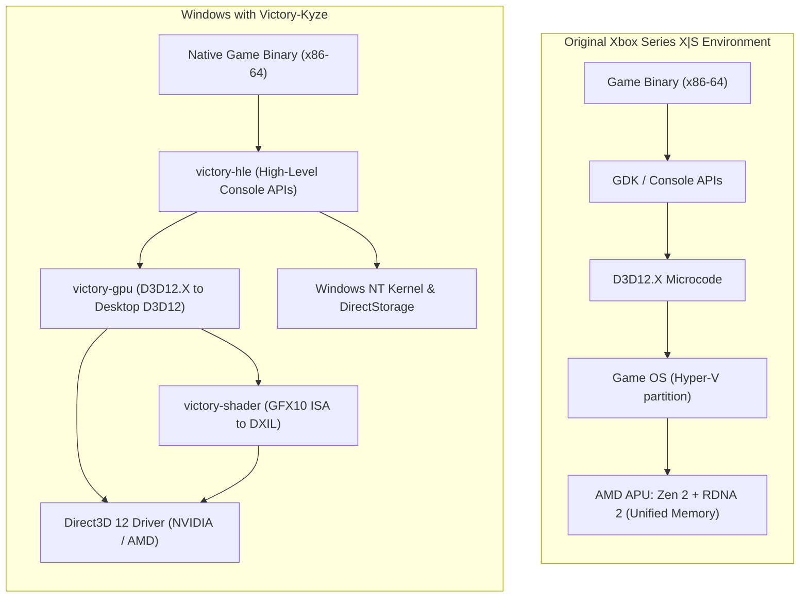

# Overview: How Victory-Kyze Runs Xbox Series Titles on PC

This document explains, without requiring specialized GPU knowledge, **why Xbox Series X|S titles cannot run unmodified on standard Windows PCs** and **how each subsystem of Victory-Kyze solves these architectural differences**.
For in-depth technical specifications, see [architecture.md](architecture.md). Current progress and performance benchmarks are detailed in the [README](../README.md).

> Note: No proprietary game assets or game data are included. See [asset policy](asset-policy.md).

---

## 1. Architectural Foundations: Similar Hardware, Divergent Software Stacks

The Xbox Series X and modern PC hardware share the same base CPU architecture (x86-64, AMD Zen 2 on console). Because of this, the **game's compiled x86-64 CPU machine code runs directly at native hardware speeds** inside the Victory-Kyze process, without instruction-level CPU emulation or JIT translation penalties.

What prevents console executables from booting directly on standard Windows is everything surrounding the CPU:

| Barrier | On Xbox Series X|S | On Standard Windows PC | How Victory-Kyze Bridges It |
|---|---|---|---|
| Console OS & System APIs | Game OS + GDK (`xgameruntime.dll`, persistent user profiles, storage APIs) | Not present on standard Windows | `victory-loader` + `victory-hle` |
| Low-level Graphics API | D3D12.X with console command recording | Standard Desktop Direct3D 12 | `victory-gpu` |
| Shader Microcode | Precompiled for console APU (GFX10 / RDNA 2 ISA) | PC GPUs consume Microsoft DXIL bytecodes | `victory-shader` |
| Memory Architecture | Unified Memory Architecture (UMA): GPU address == CPU address | Distinct system RAM and dedicated discrete VRAM | `victory-gpu` (staging buffers, `shadow`, `memory`) |
| Proprietary Formats | Console texture tiling, hardware BCPack, XMA audio | Not natively supported by PC drivers | `victory-formats` |
| Wavefront Size | Dynamic 32 or 64 lanes per shader on RDNA | NVIDIA: locked 32-thread warps | `victory-shader` (whole-wave transforms and warp shuffles) |
| Ray Tracing (BVH) | Compute traversal with hardware ray-box intersection intrinsics | Desktop D3D12 Raytracing / Agility SDK | `victory-shader` (DXIL instruction emulation) |

---

## 2. Architectural Comparison: Xbox Stack vs. Victory-Kyze on PC

---

## 3. Subsystem Breakdown

1. **`victory-loader`**: Maps Scarlett Xbox PE images into high-address spaces, initializes the Vectored Exception Handler (VEH) to suppress assert suicide traps (`0x80000003` / `int3` and NULL-page writes), and resolves dynamic symbol imports.
2. **`victory-hle`**: Emulates Microsoft Gaming.Desktop / Scarlett runtime services (User management, Storage, Audio, System queries).
3. **`victory-gpu`**: Intercepts low-level D3D12.X command lists, manages descriptor heaps, enforces discrete GPU selection via DXGI, and runs an asynchronous Win32 message pump to prevent DWM freezes.
4. **`victory-shader`**: Decompiles AMD GFX10 machine code directly into DXIL bytecodes compatible with NVIDIA and Intel graphics drivers.
5. **`victory-formats`**: Unpacks micro-tiled textures, depth maps, and BC compressed buffers in real-time.
